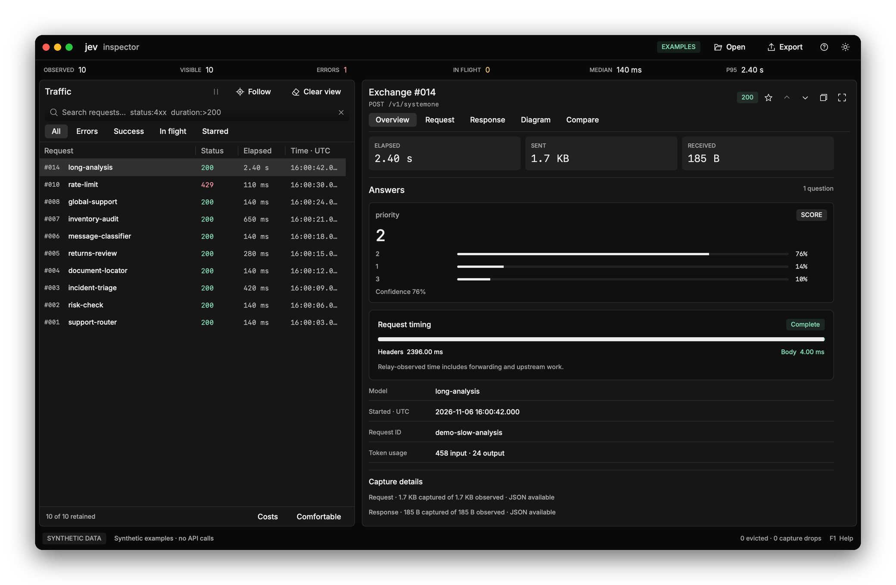
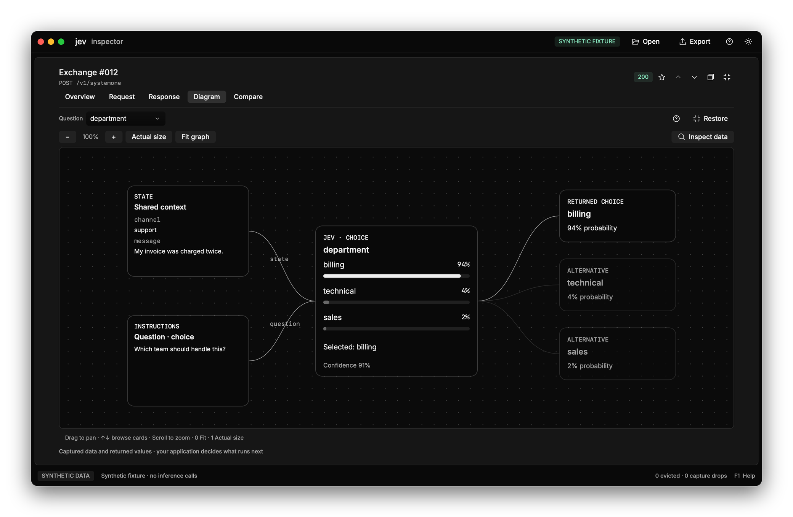

<div align="center">

# Jev Inspector

A native desktop inspector for TypeSafe API traffic.<br />
Point your backend at a local relay and see every request, response, and Jev answer, with no changes to your app's UI.

[](LICENSE)
[](https://www.rust-lang.org/)
[](#try-it-locally)
[](#status)

[Try it locally](#try-it-locally) · [Connect your backend](docs/bridge-quickstart.md) · [Workspace guide](docs/inspector-workspace.md) · [Contributing](CONTRIBUTING.md)

</div>



> **Experimental.** Expect rough edges and breaking changes. The screenshots use synthetic data.

## How it works

```text
Your backend ──▶ jev-bridge ──▶ TypeSafe API
                    │
                    ▼
              jev-inspector
```

`jev-bridge` is a local relay. It forwards your backend's requests to the TypeSafe API unchanged and keeps a bounded history of what it saw. `jev-inspector` reads that history through a separate local API, so closing the inspector never interrupts your traffic. Both listen on loopback only.

Built in Rust with [Rune](https://github.com/anomalyco/rune).

## What you can inspect

| View | What it shows |
| --- | --- |
| Traffic | Live requests with filters, search (`status:4xx duration:>200`), stars, pause, and Follow. |
| Overview | Answers with probabilities and confidence, request timing, token usage, and capture details. |
| Request / Response | Formatted JSON or an expandable property tree, with find and copy. |
| Diagram | Each Jev question as connected cards: inputs, the returned choice, and its alternatives. |
| Compare | A side-by-side or unified diff against a baseline exchange, with warnings for incomplete captures. |
| Costs | Estimated spend per model from published pricing, or your own rates. |

Export a session, CSV summaries, or a single exchange, and reopen saved sessions offline.



## Try it locally

You need Git, Python 3.11.4+, and Rust through [rustup](https://rustup.rs/).

- **macOS:** Xcode Command Line Tools (`xcode-select --install`).
- **Windows:** Visual Studio Build Tools with **Desktop development with C++** and a Windows SDK.

```sh
git clone https://github.com/diegoag64/jev-inspector.git
cd jev-inspector
python3 dev.py demo
```

Use `python` on Windows. The launcher prepares the pinned Rune sources, builds the binaries, starts a mock API and the relay, and opens the inspector. The first build takes a few minutes.

The demo sends one batch of synthetic requests. It needs no API key and never contacts TypeSafe. Close the window to stop everything. Add `--continuous` to keep traffic flowing, or `--skip-build` when the binaries are current.

To browse curated examples without a relay:

```sh
python3 tools/prepare_rune.py
cargo run -p jev-inspector -- --showcase
```

## Inspect your own backend

After `python3 tools/prepare_rune.py`, run each in its own terminal:

```sh
cargo run -p jev-bridge -- --capture-bodies     # 1. the relay
cargo run -p jev-inspector                      # 2. the inspector

export TYPESAFE_BASE_URL=http://127.0.0.1:8787  # 3. your backend, as usual
```

Your backend keeps its existing API key; the relay forwards it upstream. Omit `--capture-bodies` to record metadata only. The [bridge quickstart](docs/bridge-quickstart.md) covers ports, capture limits, and PowerShell. The [workspace guide](docs/inspector-workspace.md) covers controls and keyboard shortcuts.

> [!IMPORTANT]
> Captured bodies can contain application data even after field-name redaction. Review exports before you share them.

## Documentation

| Guide | What you'll find |
| --- | --- |
| [Bridge quickstart](docs/bridge-quickstart.md) | Run the relay in front of your backend |
| [Workspace guide](docs/inspector-workspace.md) | Controls, shortcuts, pricing, and capture limits |
| [Relay behavior](docs/bridge-v1.md) | What the relay forwards, stores, and rejects |
| [Diagram components](docs/diagrams.md) | The reusable `rune-diagram` crate |
| [Inspector examples](docs/inspector-examples.md) | Fixtures, headless renders, and motion checks |
| [Contributing](CONTRIBUTING.md) | Build, verify, and open pull requests |

## Project layout

| Path | Purpose |
| --- | --- |
| `crates/jev-inspector` | Rune desktop UI |
| `crates/jev-bridge` | Local HTTP relay and capture API |
| `crates/jev-protocol` | Shared exchange and session types |
| `crates/rune-diagram` | Reusable graph and answer-card components |
| `examples/demo-requests.json` | Synthetic request and response catalog |
| `dev.py` | Local demo launcher |
| `tools/` | Rune source preparation and inspector QA scripts |
| `qa.py` | Upstream Rune gallery checks and performance comparisons |

## Status

The inspector is developed on macOS and Windows; Linux is untested. Automated headless checks cover layout and application behavior. They do not certify native clipboard, file dialogs, or screen-reader speech, which have [manual checklists](docs/native-checklist.md). There is no hosted CI, so checks run locally.

Want an in-app React drawer instead of a desktop window? See [Jev DevTools](https://github.com/diegoag64/jev-devtools).

## License

Jev Inspector is released under the [MIT License](LICENSE). It builds against a pinned revision of [Rune](https://github.com/anomalyco/rune) (MIT, © Anomaly) with a small [focus patch](docs/rune-focus-patch.md).

Jev Inspector is an independent community project and is not affiliated with TypeSafe AI. TypeSafe branding belongs to its owner.
